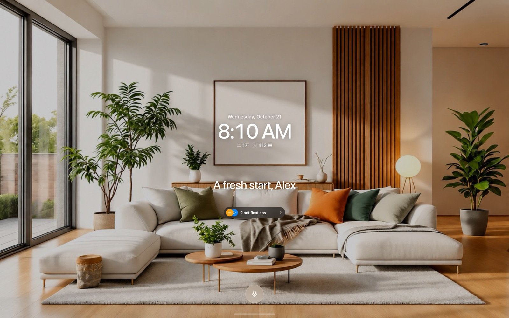
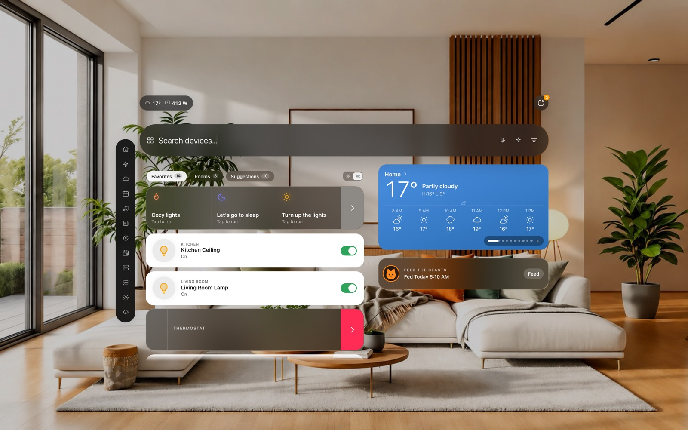
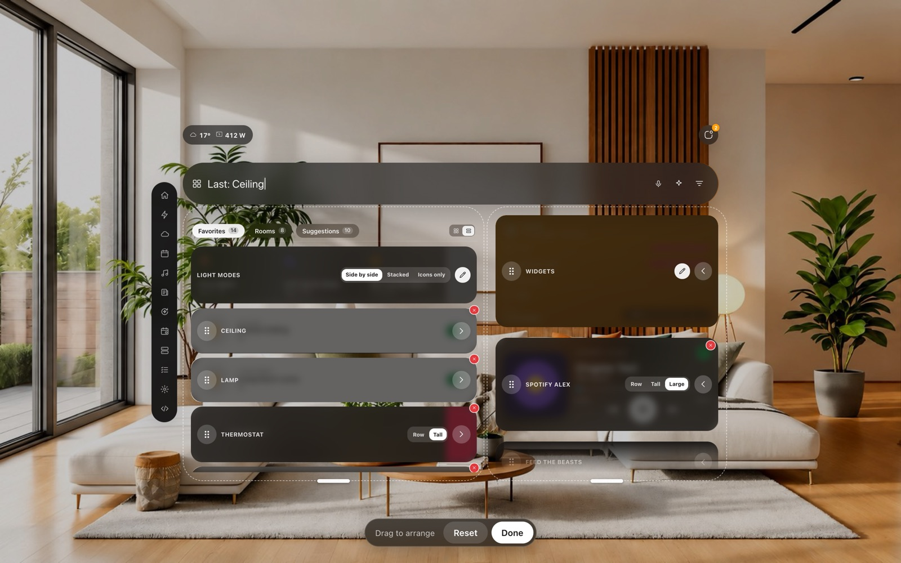
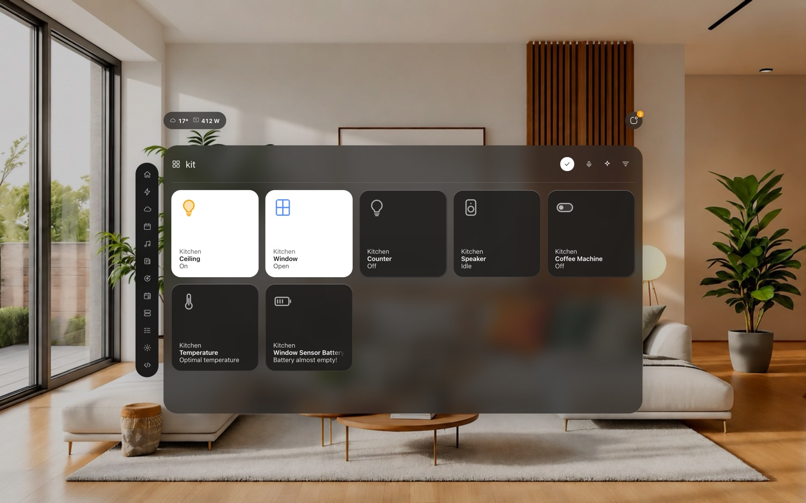
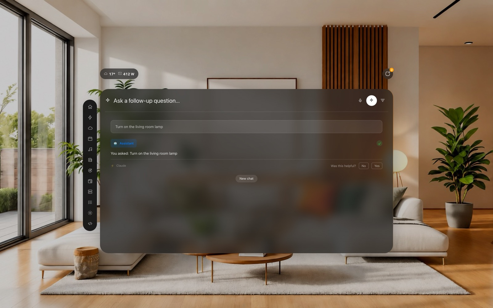
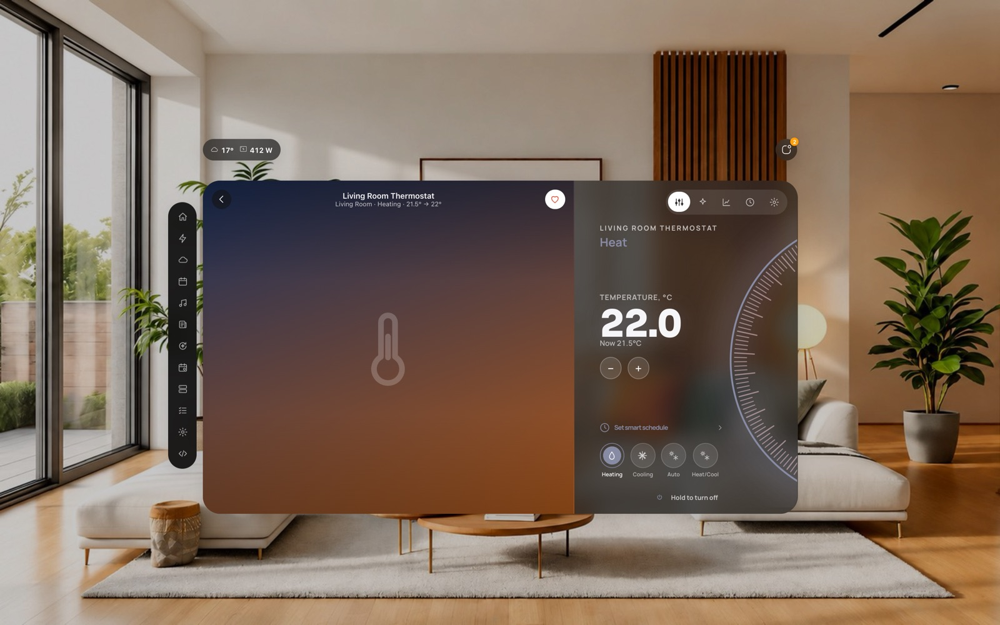
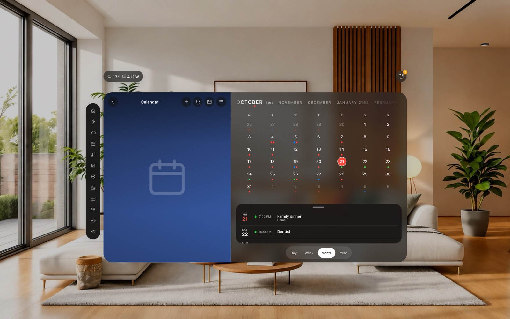
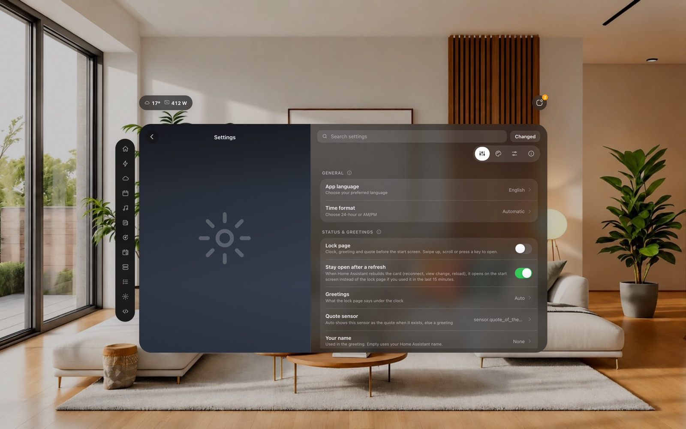

# Okie Motor

**A search-and-control dashboard for Home Assistant that feels like an app.** One JavaScript card, plus an optional native iPhone / iPad app and home screen widgets.

It starts on a lock page with a clock, has one search bar that finds any device, room or app (and can ask your Assist agent, by typing or by voice), a start screen you
arrange by touch, detail views with circular dials, and its own Calendar, To-do, Energy, Schedules, News and Settings apps. It runs in a browser, in the Home Assistant
companion app, in the **Okie Home** iOS app, and on a wall tablet.

| | |
|---|---|
|  |  |
| **Lock page**: clock, weather, power, a greeting or quote. Tap the microphone and talk to the assistant right there. | **Start screen**: favorites, a swipeable Widgets card, cameras, a feeder card, search, the dock on the left. |
|  |  |
| **Hold any card to arrange**: drag between the two columns, pick Row / Tall / Large for a card, set the height of each column. | **Search**: typo-tolerant, understands "living room light", offers chips as you type. |
|  |  |
| **Ask anything**: your Assist agent in the search bar. The devices it touched appear as tiles. | **Detail view** with a circular dial, history, schedule and context. |
|  |  |
| **Calendar**: day, week, month, year, with an endless date strip you scroll with a finger (this demo runs in the year 2191, just for fun). | **Settings** with search, tabs and a "Changed" badge. Export and import them as a file. |

More screenshots (iPad, iPhone, rooms, energy, light modes) are in [docs/screenshots](docs/screenshots).

> The pictures are the browser demo with made-up sample data. Open [`dist/okie-demo.html`](dist/okie-demo.html) (double-click, no server) to try the whole card against a pretend Home Assistant.

> **Built on the work of two other projects:** [Fast Search Card](https://github.com/fastender/Fast-Search-Card) (the design) and [Hemma](https://github.com/willsanderson/Hemma) (the framework). Without them this would not exist, see [Credits](#-credits).

## What is in this repository

| Folder | What it is |
|---|---|
| [`dist/`](dist) | The built card `okie-motor.js` (one file, no dependencies), the one-file installer `okie-install.py` for [Hemma](https://github.com/willsanderson/Hemma) users, and the offline demo `okie-demo.html`. |
| [`src/`](src) | The card's source: 49 plain JavaScript modules, concatenated by `tools/build.py`. |
| [`ios-app/`](ios-app) | **Okie Home**: a SwiftUI app that shows your dashboard full screen, signs in with Home Assistant's own login, speaks to the card (haptics, microphone, widgets) and has native widgets. Built from source with Xcode. |
| [`widget/`](widget) | Home screen widgets as [Scriptable](https://scriptable.app) scripts (thermostat, weather, feeder, shortcuts) for people who do not want to build the app. |
| [`demo/`](demo) | **Demo settings** you can import into the card, and example dashboards. |
| [`docs/`](docs) | Guides, the feature list, architecture notes. |
| [`tests/`](tests), [`harness/`](harness) | 440 unit tests and a browser harness with a mock Home Assistant. |

The whole project in one page: [PROJECT.md](PROJECT.md).

## Quick start on a fresh Home Assistant

The long version with every click is [docs/guides/00-START-HERE.md](docs/guides/00-START-HERE.md). The short one:

1. **Install the card.** In HACS add this repository as a custom repository (category *Dashboard*) and install **Okie Motor**; or copy `dist/okie-motor.js` to `/config/www/` and add `/local/okie-motor.js` as a JavaScript module under *Settings > Dashboards > ⋮ > Resources* ([guide](docs/guides/01-INSTALL-THE-CARD.md)).
2. **Make a dashboard.** *Settings > Dashboards > Add dashboard*, give it the URL **`okie-tablet`**, open it, ⋮ > *Raw configuration editor*, paste [`demo/dashboard-okie.yaml`](demo/dashboard-okie.yaml) ([guide](docs/guides/02-CREATE-THE-DASHBOARD.md)).
3. **Import the demo settings.** Open the card's Settings > About > *Backup & sync* > *Import settings* and choose [`demo/okie-demo-settings.json`](demo/okie-demo-settings.json) ([guide](docs/guides/03-IMPORT-THE-DEMO-SETTINGS.md)).
4. **Open it on each device:** [computer](docs/guides/04-COMPUTER-BROWSER.md), [iPhone / iPad in Safari or the companion app](docs/guides/05-IPHONE-IPAD-SAFARI-AND-COMPANION-APP.md), [the Okie Home app](docs/guides/06-OKIE-HOME-IOS-APP.md), [widgets](docs/guides/07-IOS-WIDGETS.md), [a wall tablet](docs/guides/08-WALL-TABLET-AND-FIRE-TABLET.md).

Having trouble? [docs/guides/09-TROUBLESHOOTING.md](docs/guides/09-TROUBLESHOOTING.md).

## What it does

* **Lock page and start screen**: clock, weather and power, a greeting or a quote, a status island that opens into notifications, and a start screen with your favorites and suggestions, one swipeable *Widgets* card (weather, to-dos, news, calendar, tips, cameras, Kindle, AWTRIX, home map), a cameras card and a pet-feeder card. It lays itself out for desktop, tablet and phone.
* **Arrange by touch**: hold a card, drag it to the other column, pick its size (Row, Tall, and a big-cover *Large* size for music players), set the height of each column; tap away to finish. Rooms arrange the same way.
* **Search that understands you**: fuzzy search, intent parsing ("kitchen light"), chip input with completion, usage learning, filters, and an **assistant** mode that talks to your Home Assistant Assist agent. The microphone sends your question by itself when you stop talking.
* **Detail views** for lights, climate (a circular thermostat dial and a weekly schedule), fans, covers, locks, media players, vacuums, cameras, sensors, weather and more, with history charts and optional video backgrounds.
* **Apps**: Calendar (day / week / month / year, create and edit events), To-do, Energy (reads HA's Energy dashboard), Schedules, News, Light modes, Server links, Assistant, Tips, What's new and a full Settings app.
* **Music cards** for Spotify and other players, in three sizes.
* **Wall tablet mode**: screensaver, deep rest, wake on motion or a doorbell, quiet hours.
* **Same settings everywhere**: favorites, rooms, look and layout are stored in Home Assistant for your user, so the browser, the phone, the iPad and the wall tablet show the same thing.
* **Okie Home (iOS)**: full-screen app, sign in once, haptics, voice, widgets (thermostat, weather, calendar, lights, feeder), stays on the screen you were on when you come back to it.
* **English and German.**

The long list: [docs/FEATURES.md](docs/FEATURES.md). Every YAML option: [docs/OPTIONS.md](docs/OPTIONS.md).

## Requirements

* A current Home Assistant (any install type) and a user that can edit dashboards (turn on *Advanced mode* in your profile to see Resources and the raw editor).
* A modern browser (Chrome, Safari, Edge, Firefox). iOS 17+ for the Okie Home app (a Mac with Xcode to build it).
* Nothing else for the card: no card_mod, no integration, no Hemma. Some screens use what you have: a `weather.*` entity, `calendar.*` and `todo.*` entities, cameras, climate devices, an Assist pipeline for the assistant.

## Status

The author uses it every day on a Home Assistant server, an iPad, an iPhone and a browser. It is one person's project: expect rough edges, and please open an issue with what you saw and which device you used. The numbers in the settings file and the layout are tuned on an iPad (9th generation) and a recent iPhone.

## Develop

```bash
npm test             # 440 unit tests (node >= 18, no dependencies; 4 installer tests need a Hemma clone next to the folder and are skipped without one)
npm run serve        # browser harness: http://127.0.0.1:4651/harness/index.html  (add ?zen=0 to skip the lock page)
npm run build        # dist/okie-motor.js, dist/okie-version.json, dist/okie-install.py   (python3 tools/build.py --no-hemma when you have no Hemma clone)
npm run demo         # dist/okie-demo.html
```

[docs/ARCHITECTURE.md](docs/ARCHITECTURE.md) explains the modules, the `ctx` contract and how to add a setting, an app or a control. [CONTRIBUTING.md](CONTRIBUTING.md) lists the rules the tests enforce. [CHANGELOG.md](CHANGELOG.md) has the history.

## License and credits

GPL-3.0-or-later, see [LICENSE](LICENSE) and [NOTICE.md](NOTICE.md) (what is borrowed from where, fonts, trademarks). Made with thanks to [Fast Search Card](https://github.com/fastender/Fast-Search-Card) and [Hemma](https://github.com/willsanderson/Hemma). Not affiliated with Home Assistant, Nabu Casa, Apple, Spotify, Hemma or Fast Search Card.

## 🏆 Credits

* Original Fast Search concept and base implementation: [fastender](https://github.com/fastender) ([Fast Search Card](https://github.com/fastender/Fast-Search-Card)). The look of the glass panels, the search bar that finds and controls everything, the detail views and the layout of the settings are the starting point of this card; I used it as my design reference and built from there. The four card-shape presets are taken from it, which is why this project is GPL-3.0-or-later too.
* Hemma customization and ongoing tweaks: [willsanderson](https://github.com/willsanderson) ([Hemma](https://github.com/willsanderson/Hemma)). The dashboard framework this card was first made to live in; the optional installer (`dist/okie-install.py`) plugs the card into it, and the sample room photo of the demo comes from its assets.

Thank you both, without your projects Okie Motor would not exist. Please give them a star. Okie Motor is an independent project: it is not made, endorsed or supported by them (details in [NOTICE.md](NOTICE.md)).

Enjoying Okie Motor? Buy me a coffee, I wanna be a full time DJ/designer ✌️😃 it's paulkmusic bby

👉 **https://ko-fi.com/paulkmusic**
